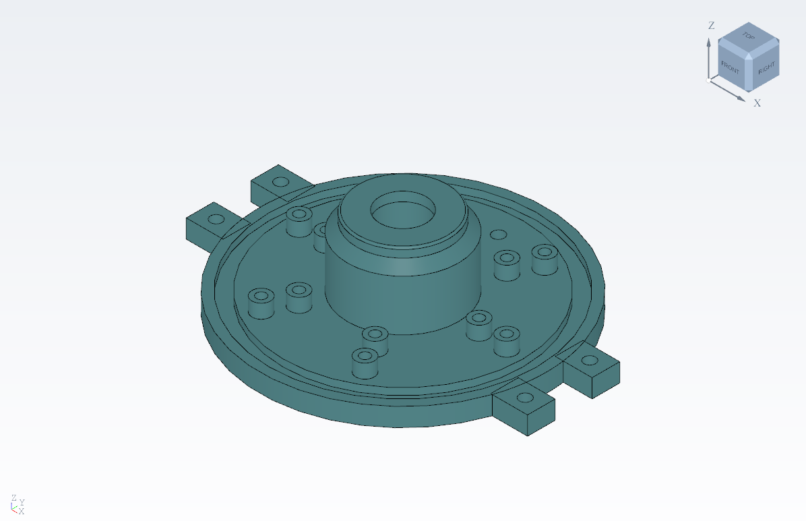
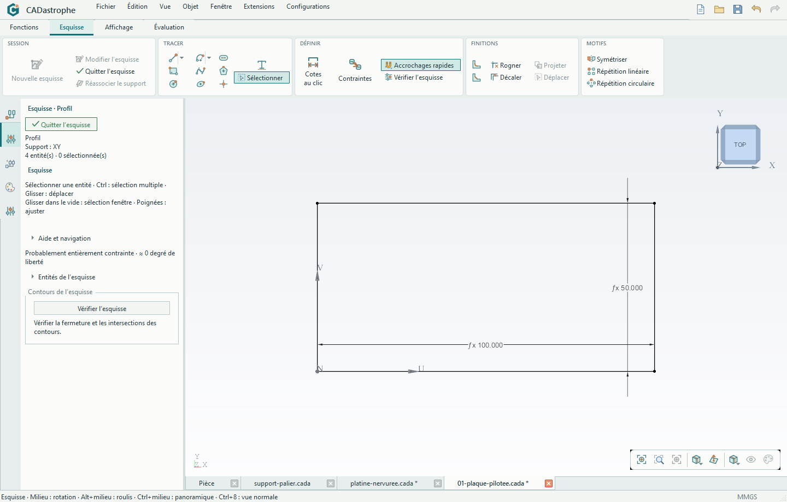
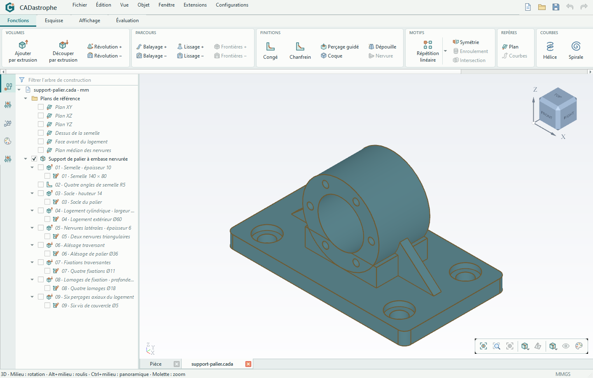
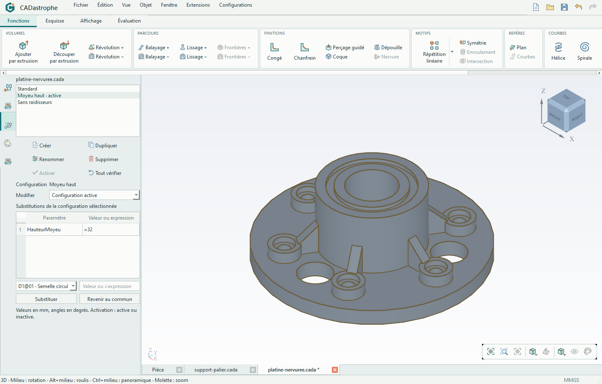
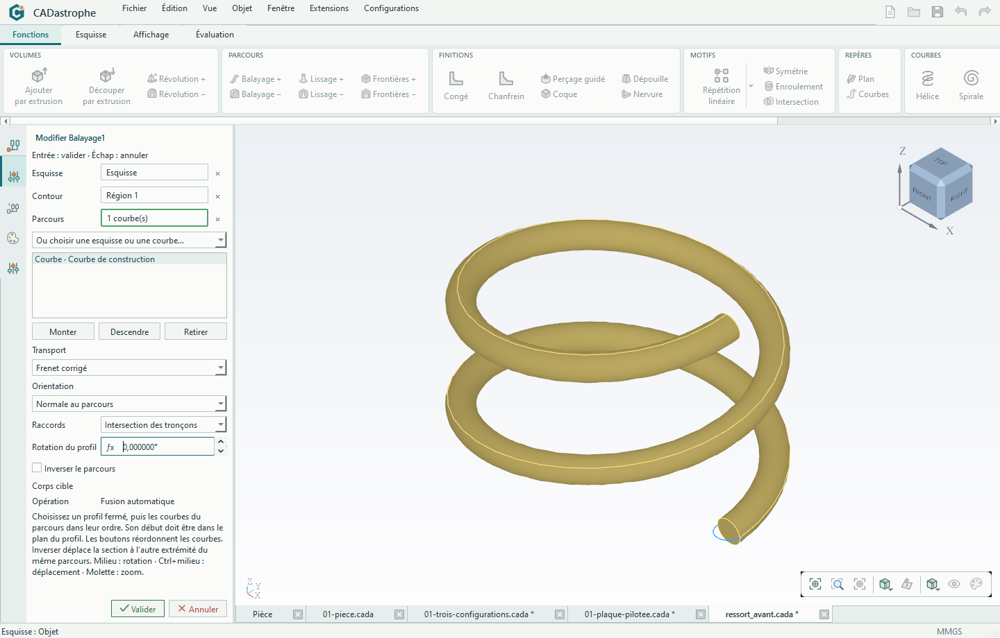

<p align="center">
  
</p>

# CADastrophe

**Concevez sans limites. Ni garanties.**

CADastrophe est une application de CAO 3D paramétrique pour le bureau. Elle permet de construire des pièces à partir d’esquisses contraintes et d’un arbre de fonctions, puis de modifier leurs dimensions à l’aide de variables et d’équations.

Le projet est en développement. La plateforme actuellement utilisée pour la validation est **Windows**.

## Téléchargement

[**Télécharger la dernière version de CADastrophe**](https://github.com/goffart-charles/CADastrophe/releases/latest)



*La [Bride Atlas](examples/bride_atlas/README.md), un exemple natif fourni avec le projet.*

## Ce que l’on peut faire

- **Dessiner et contraindre** : esquisses sur plans ou faces planes, points, segments, arcs, cercles, ellipses, splines et texte en contours ; cotations, contraintes, rognage et décalage.
- **Construire des volumes** : extrusions et révolutions additives ou soustractives, balayages, lissages, congés, chanfreins, coques et dépouilles.
- **Créer des courbes** : hélices cylindriques ou coniques, spirales planes et courbes 3D interpolées par points, utilisables comme parcours de balayage.
- **Piloter une pièce** : variables globales, bibliothèques de variables partagées dans un fichier texte, expressions dans les cotations, répétitions associatives d’esquisse et motifs de fonctions linéaires, circulaires ou symétriques.
- **Reprendre une construction** : modifier les premières étapes, réparer les références, désactiver des fonctions et insérer une opération dans l’historique, avec annulation et rétablissement.
- **Décliner une pièce** : configurations partageant le même arbre, avec valeurs, expressions et activations propres à chaque variante ; modification commune ou locale explicite.
- **Travailler sur plusieurs documents** : projets natifs `.cada`, copie de constructions paramétriques, préférences et récupération.
- **Mesurer et échanger** : longueurs, surfaces, volumes et masses ; matériaux avec masse volumique par corps ; import STEP et exports STEP, STL, OBJ, 3MF et glTF/GLB.
- **Étendre l’application** : plugins Python locaux, actions, panneaux, outils interactifs et types persistants ; voir le [guide de création des plugins](plugins/docs/README.md).

## Découverte

Quelques fonctionnalités de CADastrophe en images.
Cliquer sur une capture pour l’agrandir.

### Esquisser et coter

Dessinez le contour d’une pièce en 2D et donnez-lui des dimensions précises.
Les contraintes maintiennent, par exemple, deux côtés perpendiculaires. Changez
une cote pour ajuster le dessin sans tout retracer.

[](examples/decouverte/02-esquisse-complete.png)

### Construire une pièce par fonctions

Le [support de palier](examples/decouverte/support-palier.cada) combine une semelle
aux angles arrondis, un logement cylindrique alésé, deux nervures, quatre fixations
lamées et six perçages axiaux. Ses neuf fonctions restent modifiables dans l’arbre.

[](examples/decouverte/01-support-palier.png)

### Décliner une pièce en plusieurs configurations

Conserver le même arbre et faire varier les paramètres selon la configuration.
La [platine à moyeu](examples/decouverte/platine-nervuree.cada) comporte six
raidisseurs répétés, six bossages lamés, trois évidements et une gorge annulaire.
Elle propose trois variantes : **Standard**, **Moyeu haut** et **Sans raidisseurs**.
La hauteur du moyeu est pilotée par une variable ; la gorge suit sa face supérieure.

[](examples/decouverte/03-platine-nervuree.png)

### Balayer un profil sur une hélice

Utiliser une courbe comme parcours et régler le balayage depuis son panneau.
Le [ressort paramétrique](tests/fonctions/courbes/ressort_avant.cada) associe une
hélice, une esquisse circulaire et une fonction de balayage.

[](examples/decouverte/04-helice.png)

## Installer et démarrer

Depuis une copie du dépôt, avec **Conda** installé :

```powershell
conda env create -f environment.yml
conda activate cadastrophe
python main.py
```

Le fichier [environment.yml](environment.yml) définit l’environnement : **Python 3.12**, **PySide6**, **pythonocc-core**, **NumPy** et **pytest**. Les dépendances géométriques sont distribuées par le canal `conda-forge`.

Pour contrôler le chargement de l’environnement et ouvrir brièvement l’application :

```powershell
python main.py --probe
python main.py --smoke
```

La [construction Windows](build/README.md) prépare un paquet autonome et un
installeur Inno Setup par utilisateur, sans demande de droits administrateur.
Les projets fournis utilisent le format `.cada` courant ; les anciens formats
de développement ne sont plus pris en charge.

## Explorer les exemples

Des projets modifiables sont inclus pour essayer la reconstruction paramétrique :

- [Bride Atlas](examples/bride_atlas/README.md) : révolutions, répétitions, symétries et finitions, avec une variante de la pièce.
- [Pièces de référence](examples/pieces_reference/README.md) : boîtier, support mécanique, poignée et raccord.
- [Exemples par fonction](tests/fonctions/) : petits projets natifs pour explorer les outils et leurs paramètres.

Ouvrir les fichiers `.cada` depuis **Fichier → Ouvrir**, puis modifier une esquisse, une cote ou une fonction de l’arbre.

## Développement

L’application s’appuie sur **Qt/PySide6** pour l’interface et **Open CASCADE**, via pythonocc-core, pour la géométrie. Les fonctions de modélisation sont organisées en [extensions locales](plugins/README.md).

La suite de tests utilise la géométrie et les fenêtres natives de l’application :

```powershell
python main.py --test-parallel
```

Sous Windows, le lanceur exécute les tests sur des bureaux privés. Les scénarios utilisant le presse-papiers sont regroupés dans une phase séparée.

Pour signaler un problème, préciser les étapes de reproduction, le comportement attendu et l’environnement utilisé. Un petit projet `.cada` permet de reproduire plus facilement un défaut de reconstruction.
