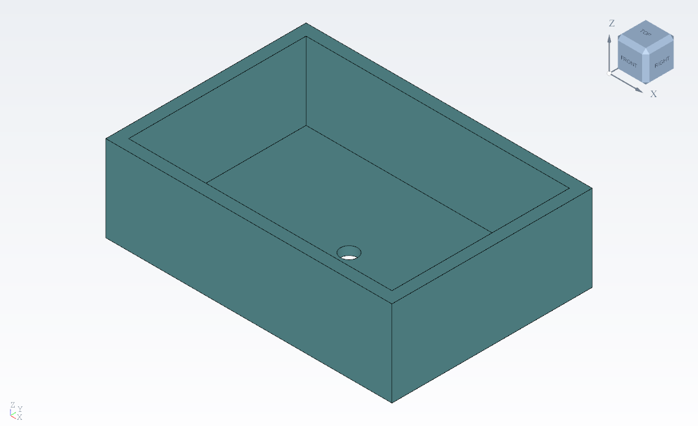
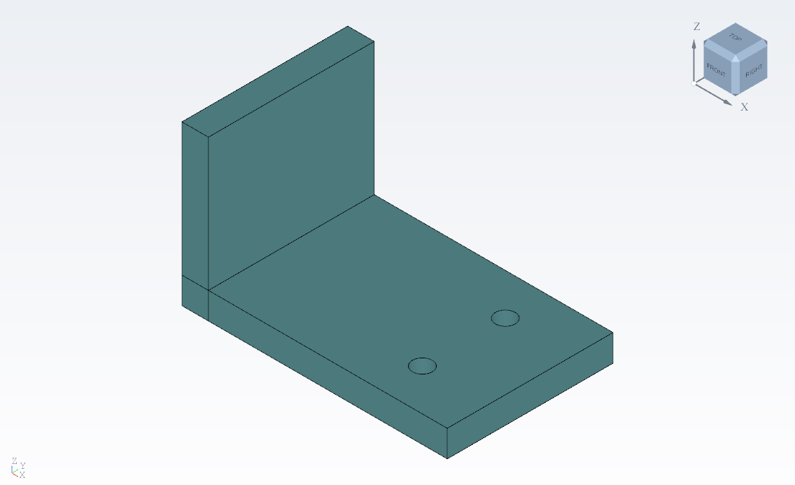
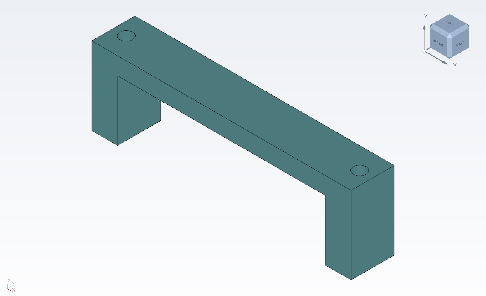
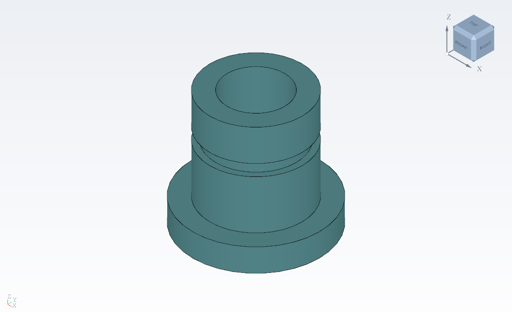

# Pièces de référence paramétriques

Ce corpus complète la [Bride Atlas](../bride_atlas/README.md). Ouvrir les fichiers
`.cada` avec les extensions Esquisse et Modélisation activées. Chaque pièce est
un solide fermé connexe, reconstruit à partir de ses esquisses et de ses recettes ;
aucune B-Rep finale ni aucun maillage n'est enregistré à la place de l'historique.
Les esquisses et plans sont masqués initialement, mais restent accessibles dans l'arbre.

## Pièces et variantes

Les dimensions sont en mm, les volumes en mm³. Chaque variante change **une seule
profondeur d'extrusion**. Les UUID des objets, les entités d'esquisse et l'ordre
des fonctions sont conservés. L'identité du document est différente pour permettre
l'ouverture simultanée de la pièce et de sa variante.

| Pièce | Construction et résultat initial | Modification de la variante |
|---|---|---|
| [Boîtier](boitier.cada) · [variante](boitier_variante.cada) | 3 fonctions : extérieur 100 × 70 × 30, poche 92 × 62 profonde de 27, trou central Ø6 traversant le fond. Parois de 4, fond de 3. | **01 · Volume extérieur** : 30 → 40. Le plan d'ouverture suit le dessus ; la poche reste profonde de 27, le fond passe à 13 et le trou reste traversant. |
| [Support mécanique](support.cada) · [variante](support_variante.cada) | 4 fonctions : semelle 80 × 50 épaisse de 8, montant de 8 × 50 montant à Z=48, trou Ø6 à (60 ; 12,5), répétition de deux trous au pas de 25 suivant Y. | **01 · Épaisseur de semelle** : 8 → 12. Le plan des trous suit la semelle, les deux perçages restent traversants ; le sommet du montant reste à Z=48. |
| [Poignée](poignee.cada) · [variante](poignee_variante.cada) | 4 fonctions : extérieur 120 × 20 × 36, dégagement inférieur large de 96 et haut de 28, deux fixations Ø6 d'entraxe 108. Les pieds font 12 de large, le pont 8 d'épaisseur. | **01 · Hauteur de poignée** : 36 → 44. Le dégagement reste haut de 28, le pont passe à 16 ; les deux fixations traversent encore les pieds. |
| [Raccord](raccord.cada) · [variante](raccord_variante.cada) | 3 fonctions : révolution d'un tube Ø32 / Ø20 long de 40, collerette Ø44 épaisse de 8, gorge annulaire entre Z=25 et Z=29 de diamètre de fond Ø28. | **02 · Épaisseur de collerette** : 8 → 12. Le tube, l'alésage et la gorge conservent leurs dimensions. |

Double-cliquer sur la fonction indiquée, modifier sa profondeur, puis valider.
Annuler doit rétablir la géométrie initiale ; Rétablir doit retrouver la variante.
Enregistrer puis rouvrir doit reconstruire le même résultat. Ces variantes sont
des projets indépendants, pas le système de configurations prévu en P03.
Le boîtier utilise une poche rectangulaire.

| Boîtier | Support mécanique |
|---|---|
|  |  |
| Poignée | Raccord |
|  |  |

## Résultats géométriques attendus

Pour une profondeur modifiée `h`, les volumes analytiques indépendants du moteur sont :

| Pièce | Volume attendu | Initial → variante |
|---|---|---|
| Boîtier | `7000h − 5704×27 − 9π(h−27)` | 55 907,176998 → 125 624,433660 |
| Support | `4000h + 400(48−h) − 18πh` | 47 547,610658 → 61 721,415987 |
| Poignée | `2400h − 1920×28 − 18πh` | 30 604,247960 → 49 351,858618 |
| Raccord | `π(156×40 + 228h − 60×4)` | 24 579,820922 → 27 444,953422 |

Les tests contrôlent ces volumes à 0,0001 mm³ près, les boîtes englobantes à
0,000001 mm près, ainsi que des points de matière et de vide éloignés des frontières.
Ils vérifient un solide fermé valide à chaque préfixe de l'historique, les références
des esquisses, le déplacement des plans supports du boîtier et du support, et les
identités après modification et réouverture.

Une rupture volontaire du contour initial doit mettre la première fonction en
erreur, bloquer ses consommateurs et retirer la forme finale. Annuler restaure
les entités d'origine et permet de recalculer le solide. L'éditeur historique réel
est également testé sur chaque variante : modification de +2 mm, validation,
annulation, rétablissement, sauvegarde, fermeture et véritable réouverture.

## Reproduire les contrôles et les mesures

Le générateur est [reference_parts.py](../reference_parts.py), avec le même
[constructeur de recettes](../parametric_example.py) que la Bride Atlas.
Le scénario est [test_reference_parts.py](../../tests/test_reference_parts.py).
Depuis PowerShell, à la racine du dépôt, avec le runtime natif local installé :

```powershell
$env:PYTHONIOENCODING = 'utf-8'
$env:PYTEST_ADDOPTS = '-k "test_reference_part_rebuild_roundtrip_and_native_editor" --tb=short'
try {
    .\run.ps1 --test-parallel
} finally {
    Remove-Item Env:PYTEST_ADDOPTS -ErrorAction SilentlyContinue
}
```

Par défaut, les projets, images et mesures sont produits dans les dossiers temporaires
des tests. Pour **régénérer les fichiers livrés**, ajouter avant la commande :

```powershell
$env:CADASTROPHE_REFERENCE_OUTPUT = "$PWD/examples/pieces_reference"
```

Retirer ensuite cette variable avec
`Remove-Item Env:CADASTROPHE_REFERENCE_OUTPUT`. Les quatre scénarios sont inclus
dans la suite courante ; aucune variable d'activation supplémentaire n'est nécessaire.

Les mesures du passage ayant généré les fichiers sont conservées dans
[boitier_validation.json](boitier_validation.json),
[support_validation.json](support_validation.json),
[poignee_validation.json](poignee_validation.json) et
[raccord_validation.json](raccord_validation.json). Le champ `status` n'est écrit
qu'après réussite de tous les contrôles de la pièce.

Les durées en secondes distinguent construction, sauvegarde, lecture et reconstruction
des recettes, recalcul complet avec `reuse=False`, modification avec recalcul, et
ouverture par la fenêtre native. Cette dernière mesure porte sur l'appel synchrone
d'ouverture ; l'attente du premier affichage et l'export PNG sont hors chronométrage.
Il s'agit d'un passage local par opération, sans moyenne statistique ni objectif de
performance pour les grandes scènes. Les images sont exportées par le viewport OCCT.
Les commandes de tests figurent dans le [README du projet](../../README.md#développement).
Les essais humains restent distincts de ces contrôles automatisés.
